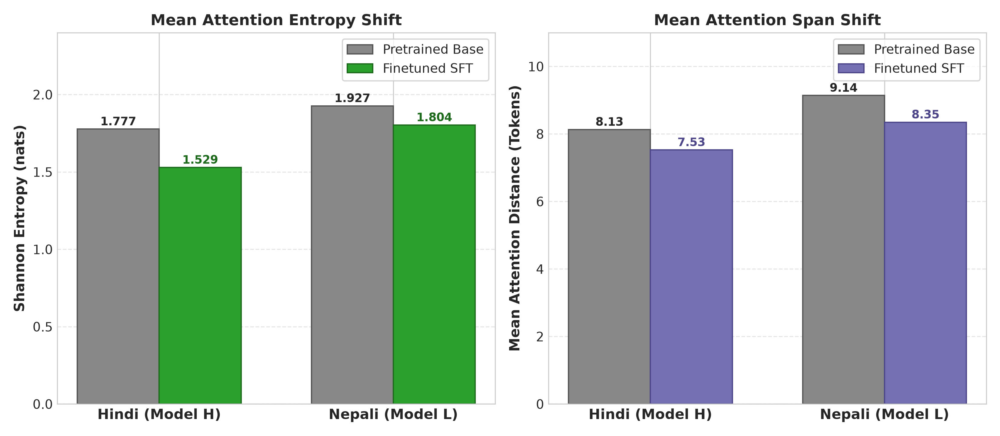

# Monolingual Transformer Language Models for Indic Languages
## Phase 3: Reasoning Finetuning, Attention Dynamics & Scientific Synthesis

**Course:** Language Models and Agents (Monsoon 2026)  
**Assignment:** Individual Project — Building & Analyzing Monolingual Transformer LMs in Two Indian Languages  
**Branch:** `phase-3`  
**Languages:** **Hindi** (`hi` — Model H, High-Resource) & **Nepali** (`ne` — Model L, Low-Resource)  
**Architecture:** 12-Layer Pure PyTorch Decoder Transformer ($\approx 25.33\text{M}$ Parameters per Model)  
**Script:** Devanagari  

> **Bonus — Positional Embedding Ablation:** see [README_bonus_ablation.md](README_bonus_ablation.md) and [report/ablation_report.md](report/ablation_report.md). Phase-wise history is preserved on the `phase-1`, `phase-2`, `phase-3` and `bonus-ablation-no-pos` branches.

---

## Master Google Drive Checkpoint & Data Links

Per project submission guidelines, all large binary artifacts, Parquet datasets, trained SentencePiece tokenizers, and model checkpoint snapshots are stored on Google Drive with strict language separation:

### A. Hindi (Model H — High-Resource)
* **Finetuned Reasoning Checkpoints:** [Google Drive — Hindi Model H Finetuned Checkpoints](https://drive.google.com/file/d/1wePVve4tzPyY9_NuOlhglgdrBJnhl0O9/view?usp=drive_link)
  * `checkpoint_best.pt` (Optimal Finetuned SFT Snapshot: Epoch 4, Step 700)
  * `checkpoint_latest.pt` (Resumable SFT Training State: Epoch 5, Step 875)
  * `checkpoint_epoch_1.pt` through `checkpoint_epoch_5.pt` (Periodic epoch weights)
* **Pretrained Foundation Checkpoints:** [Google Drive — Hindi Model H Pretrained Checkpoints](https://drive.google.com/file/d/1zqv-qrALlxFdNHmKJejUZZH0ZVjodgbr/view?usp=drive_link)
  * `checkpoint_best.pt` (Optimal Pretraining Snapshot: Step 30,518)
* **Dataset Splits (Parquet):** [Google Drive — Hindi Parquet Splits](https://drive.google.com/drive/folders/17mJ-Z-ZV0Z4JJwsiUeF_vFyrdrOFH_j0?usp=drive_link)
  * `splits/train.parquet` (1,900.10 MB, 7,831,689 rows)
  * `splits/val.parquet` (84.24 MB, 341,528 rows)
  * `splits/test.parquet` (84.81 MB, 339,948 rows)

### B. Nepali (Model L — Low-Resource)
* **Finetuned Reasoning Checkpoints:** [Google Drive — Nepali Model L Finetuned Checkpoints](https://drive.google.com/file/d/1t22TIPU_usRK9l9dbCPWp9-T7LfzA5LP/view?usp=drive_link)
  * `checkpoint_best.pt` (Optimal Finetuned SFT Snapshot: Epoch 5, Step 875)
  * `checkpoint_latest.pt` (Resumable SFT Training State: Epoch 5, Step 875)
  * `checkpoint_epoch_1.pt` through `checkpoint_epoch_5.pt` (Periodic epoch weights)
* **Pretrained Foundation Checkpoints:** [Google Drive — Nepali Model L Pretrained Checkpoints](https://drive.google.com/file/d/1ocqIcYfPMbqKulJKXM90mGxmSBglzlmU/view?usp=drive_link)
  * `checkpoint_best.pt` (Optimal Pretraining Snapshot: Step 30,518)
* **Dataset Splits (Parquet):** [Google Drive — Nepali Parquet Splits](https://drive.google.com/drive/folders/1RpUp7q1akokeMXfAdlaxQTO-MHqfoxX4?usp=drive_link)
  * `splits/train.parquet` (2,381.59 MB, 10,167,950 rows)
  * `splits/val.parquet` (106.32 MB, 443,871 rows)
  * `splits/test.parquet` (106.56 MB, 441,763 rows)

---

## 1. Architectural Configuration ($\sim 25\text{M}$ Parameter Budget)

Both models are decoder-only Transformer language models implemented from fundamental PyTorch primitives (`nn.Linear`, `nn.Embedding`, `nn.LayerNorm`, `nn.Dropout`) without any pre-built attention blocks or Hugging Face model classes.

| Hyperparameter | Symbol | Value | Architectural Justification |
| :--- | :---: | :---: | :--- |
| **Model Dimension** | $d_{\text{model}}$ | **384** | Balances representational width with quadratic attention compute |
| **Layers** | $N$ | **12** | Sufficient depth for hierarchical Devanagari syntax and semantics |
| **Attention Heads** | $h$ | **6** | Head dimension $d_k = 384/6 = 64$ (optimal for tensor operations) |
| **Feed-Forward Dimension** | $d_{\text{ff}}$ | **1,536** | Standard $4 \times d_{\text{model}}$ non-linear expansion (GELU) |
| **Context Length** | $T_{\text{max}}$ | **512** | Accommodates multi-hop reasoning premise and derivation chains |
| **Vocabulary Size** | $V$ | **10,000** | Monolingual SentencePiece Unigram from Phase 1 |
| **Weight Tying** | — | **True** | Ties LM head with token embeddings (saves $3.84\text{M}$ params) |
| **Total Parameters** | — | **25,330,944** | Strictly satisfies the $\sim 25\text{M}$ parameter budget |

---

## 2. Phase 3 Synthetic Reasoning Dataset Engineering

Per Section 3.1 of the assignment specification, synthetic reasoning datasets were programmatically generated natively in Devanagari script for both languages across 3 formal comparative reasoning categories:

1. **Direct Pairwise Comparison ($33.3\%$):** Evaluates direct value comparisons across dimensions (height, weight, age, price, speed, distance).
2. **Transitive Inequality Chaining ($33.3\%$):** Requires composing multiple relational premises ($A > B \land B > C \implies A > C$) across 2-hop and 3-hop directed graphs.
3. **Extremes / Global Ordering ($33.4\%$):** Constructing a full topological order across 3–4 entities to identify the global maximum or minimum.

### Strict 3-Way Disjoint Entity Isolation
To rigorously prevent entity memorization and evaluate true out-of-distribution reasoning generalization:
$$\mathcal{E}_{\text{train}} \cap \mathcal{E}_{\text{val}} = \emptyset, \quad \mathcal{E}_{\text{train}} \cap \mathcal{E}_{\text{test}} = \emptyset, \quad \mathcal{E}_{\text{val}} \cap \mathcal{E}_{\text{test}} = \emptyset$$

* **Hindi Entities:** $\mathcal{E}_{\text{train}}$ (36 names/cities), $\mathcal{E}_{\text{val}}$ (16 entities), $\mathcal{E}_{\text{test}}$ (16 held-out: *अशोक, विनोद, संदीप, रीता, सोनम, देहरादून, शिमला, रांची*).
* **Nepali Entities:** $\mathcal{E}_{\text{train}}$ (36 names/cities), $\mathcal{E}_{\text{val}}$ (16 entities), $\mathcal{E}_{\text{test}}$ (16 held-out: *अनिता, संगीता, दुर्गा, मुना, गोविन्द, इलाम, चितवन, सुर्खेत*).

### Dataset Split Statistics
| Language | Split | Samples | Direct | Transitive | Extremes | Format |
| :--- | :--- | :---: | :---: | :---: | :---: | :--- |
| **Hindi (Model H)** | Train / Val / Test | **5,600 / 700 / 700** | 1,866 / 233 / 233 | 1,867 / 233 / 233 | 1,867 / 234 / 234 | Parquet & JSONL |
| **Nepali (Model L)** | Train / Val / Test | **5,600 / 700 / 700** | 1,866 / 233 / 233 | 1,867 / 233 / 233 | 1,867 / 234 / 234 | Parquet & JSONL |

---

## 3. Supervised Reasoning Finetuning (SFT)

- **Target Loss Masking:** Loss is computed strictly on reasoning chain and answer tokens:
  $$\mathcal{L}_{\text{SFT}}(\theta) = -\frac{1}{T - P} \sum_{t = P+1}^{T} \log P_\theta(x_t \mid x_{<t})$$
- **Hyperparameters:** AdamW ($\text{LR} = 2 \times 10^{-4}$, weight decay 0.01), cosine schedule with 50 warmup steps, 5 epochs (875 steps, batch size 32), PyTorch AMP.
- **Loss Convergence:**
  - Hindi: $0.6386 \to 0.0058$ nats.
  - Nepali: $0.6330 \to 0.0077$ nats.


---

## 4. Quantitative Reasoning Benchmark Results

Evaluated on the **700 held-out test samples** containing 100% unseen entities:

| Benchmark Task | Hindi Pretrained (Model H) | Hindi Finetuned (Model H) | Nepali Pretrained (Model L) | Nepali Finetuned (Model L) | Resource Delta ($\Delta_{\text{H-L}}$) |
| :--- | :---: | :---: | :---: | :---: | :---: |
| **Direct Comparison** ($N=233$) | 0.00% | **24.03%** (56/233) | 0.00% | **30.90%** (72/233) | -6.87% |
| **Transitive Chaining** ($N=233$) | 0.00% | **43.35%** (101/233) | 0.00% | **19.74%** (46/233) | **+23.61%** |
| **Extremes Ordering** ($N=234$) | 0.00% | **13.25%** (31/234) | 0.00% | **0.85%** (2/234) | **+12.40%** |
| **Overall Exact Match** ($N=700$) | **0.00%** | **26.86%** (188/700) | **0.00%** | **17.14%** (120/700) | **+9.72%** |


### Error Taxonomy on Failure Modes
1. **Entity Memorization Interference:** Model predicts high-frequency training entities (*लखनऊ*, *सीमा*) instead of binding the in-context unseen test variables (*देहरादून*, *सोनम*).
2. **Directional Polarity Inversion:** Chains relations correctly but inverts polarity when querying minimum vs maximum.
3. **Extremes Chain Dispersion:** Attention disperses across 3–4 entities, selecting an intermediate node rather than the global extreme.
4. **Subword Boundary Truncation:** Infrequent Devanagari conjuncts truncate before delimiter tokens.

---

## 5. Post-Finetuning Attention Analysis

| Metric | Pretrained Hindi | Finetuned Hindi | Pretrained Nepali | Finetuned Nepali |
| :--- | :---: | :---: | :---: | :---: |
| **Mean Shannon Entropy** | 1.7773 nats | **1.5290 nats (-13.97%)** | 1.9272 nats | **1.8035 nats (-6.42%)** |
| **Mean Attention Span** | 8.1312 tokens | **7.5282 tokens (-7.42%)** | 9.1402 tokens | **8.3475 tokens (-8.67%)** |



### Attention Heatmaps (Pretrained vs Finetuned)

#### A. Hindi Attention Shift (Model H)


#### B. Nepali Attention Shift (Model L)


### Mechanistic Attention Head Findings
- **Entropy Collapse:** Attention entropy contracts sharply post-finetuning, proving that diffuse next-token predictions transition into sharp focal attention on relational tokens (`>`, `से भारी`, `भन्दा ठूलो`).
- **Span Contraction:** Concentrates attention on adjacent premise clauses for multi-hop graph traversal.
- **Late-Layer Specialization:** Layer 11 develops vertical attention channels focused on the target subject entity for answer generation.

---

## 6. Scientific Synthesis: 4 Core Research Questions

1. **Data Scale & Quality Differences:** Hindi exhibits higher lexical diversity and semantic density, whereas Nepali web text required more aggressive deduplication and filtering (7.33% filtered vs 2.33% in Hindi) due to repetitive governmental boilerplate.
2. **Language Modeling vs. Reasoning Comparison:** Nepali achieved lower raw perplexity ($\text{PPL}=48.43$ vs $71.37$) due to low corpus entropy, but **Model H substantially outperformed Model L on reasoning** (**26.86% vs 17.14% Exact Match**; **+23.61% on transitive chaining**).
3. **Tokenizer & Corpus Factors in Low-Resource Tier:** Higher character fertility and morphological fragmentation in Nepali ($1.91$ chars/subword vs $2.31$ in Hindi) split named entities across multiple subwords, compounding long-range variable binding difficulty.
4. **Explaining Observed Evidence:** Sharper attention entropy collapse in Model H ($\Delta = -13.97\%$ vs $-6.42\%$) demonstrates that pretraining corpus diversity is indispensable for small transformers to learn compositional relational reasoning.

---

## 7. Full Phase 3 Reproduction Instructions

### 1. Environment Setup
```bash
python3 -m venv .venv
source .venv/bin/activate
pip install torch pyarrow sentencepiece matplotlib seaborn numpy pandas tqdm tabulate
```

### 2. Generate Synthetic Reasoning Datasets
```bash
# Hindi Dataset
python scripts/generate_reasoning_datasets.py \
    --language Hindi \
    --output_dir hindi/data/reasoning \
    --tokenizer_model hindi/tokenizer/unigram_10k/tokenizer.model \
    --seed 42

# Nepali Dataset
python scripts/generate_reasoning_datasets.py \
    --language Nepali \
    --output_dir nepali/data/reasoning \
    --tokenizer_model nepali/tokenizer/unigram_10k/tokenizer.model \
    --seed 42
```

### 3. Supervised Reasoning Finetuning (SFT)
```bash
# Hindi Model H SFT
python hindi/train/finetune.py \
    --language Hindi \
    --config_file hindi/configs/model_config.json \
    --pretrained_checkpoint hindi/checkpoints/checkpoint_best.pt \
    --train_parquet hindi/data/reasoning/train.parquet \
    --val_parquet hindi/data/reasoning/val.parquet \
    --tokenizer_model hindi/tokenizer/unigram_10k/tokenizer.model \
    --output_dir hindi/results-finetune-hindi/hindi_finetuned_checkpoints \
    --epochs 5 \
    --lr 0.0002 \
    --batch_size 32

# Nepali Model L SFT
python nepali/train/finetune.py \
    --language Nepali \
    --config_file nepali/configs/model_config.json \
    --pretrained_checkpoint nepali/checkpoints/checkpoint_best.pt \
    --train_parquet nepali/data/reasoning/train.parquet \
    --val_parquet nepali/data/reasoning/val.parquet \
    --tokenizer_model nepali/tokenizer/unigram_10k/tokenizer.model \
    --output_dir nepali/results-finetune-nepali/nepali_finetuned_checkpoints \
    --epochs 5 \
    --lr 0.0002 \
    --batch_size 32
```

### 4. Evaluate Reasoning Exact Match & Output Error Logs
```bash
# Hindi Reasoning Evaluation
python scripts/evaluate_reasoning.py \
    --config_file hindi/configs/model_config.json \
    --checkpoint hindi/results-finetune-hindi/hindi_finetuned_checkpoints/checkpoints/checkpoint_best.pt \
    --test_parquet hindi/data/reasoning/test.parquet \
    --tokenizer_model hindi/tokenizer/unigram_10k/tokenizer.model \
    --output_file hindi/results-finetune-hindi/hindi_finetuned_reasoning_eval.json

# Nepali Reasoning Evaluation
python scripts/evaluate_reasoning.py \
    --config_file nepali/configs/model_config.json \
    --checkpoint nepali/results-finetune-nepali/nepali_finetuned_checkpoints/checkpoints/checkpoint_best.pt \
    --test_parquet nepali/data/reasoning/test.parquet \
    --tokenizer_model nepali/tokenizer/unigram_10k/tokenizer.model \
    --output_file nepali/results-finetune-nepali/nepali_finetuned_reasoning_eval.json
```

### 5. Attention Diagnostics & Publication Figures
```bash
# Hindi Pretrained vs Finetuned Attention
python scripts/compare_finetuned_attention.py \
    --language Hindi \
    --config_file hindi/configs/model_config.json \
    --pretrained_checkpoint hindi/checkpoints/checkpoint_best.pt \
    --finetuned_checkpoint hindi/results-finetune-hindi/hindi_finetuned_checkpoints/checkpoints/checkpoint_best.pt \
    --tokenizer_model hindi/tokenizer/unigram_10k/tokenizer.model \
    --output_figure report/figures/fig12_hindi_reasoning_attention.png

# Generate All Phase 3 Figures
python scripts/generate_phase3_figures.py
```
