# Monolingual Transformer Language Models for Indic Languages

**Course:** Language Models and Agents (Monsoon 2026)  
**Assignment:** Individual Project — Building & Analyzing Monolingual Transformer LMs in Two Indian Languages  
**Languages:** **Hindi** (`hi` — Model H, High-Resource) & **Nepali** (`ne` — Model L, Low-Resource)  
**Architecture:** 12-Layer Pure PyTorch Decoder Transformer ($\approx 25.33\text{M}$ Parameters per Model)  
**Script:** Devanagari  

This repository contains the complete project in one place:

| Part | Scope | Original Branch |
| :--- | :--- | :--- |
| **[Phase 1](#phase-1--data-engineering--tokenization)** | Corpus collection, cleaning, deduplication, 92/4/4 splits, Unigram tokenizers | `phase-1` |
| **[Phase 2](#phase-2--model-implementation-pretraining--evaluation)** | From-scratch Transformer, pretraining on ~500M tokens, LM & generation evaluation, attention diagnostics | `phase-2` |
| **[Phase 3](#phase-3--reasoning-finetuning-attention-dynamics--scientific-synthesis)** | Synthetic reasoning datasets, supervised finetuning, exact-match evaluation, attention shift analysis | `phase-3` |
| **[Bonus](#bonus--positional-embedding-ablation-study)** | Positional embedding ablation study (Hindi) | `bonus-ablation-no-pos` |

The phase branches are kept in this repository for history; `main` contains everything.

---

## Table of Contents

- [Google Drive Checkpoint & Data Links](#google-drive-checkpoint--data-links)
- [Repository Structure](#repository-structure)
- [Phase 1 — Data Engineering & Tokenization](#phase-1--data-engineering--tokenization)
- [Phase 2 — Model Implementation, Pretraining & Evaluation](#phase-2--model-implementation-pretraining--evaluation)
- [Phase 3 — Reasoning Finetuning, Attention Dynamics & Scientific Synthesis](#phase-3--reasoning-finetuning-attention-dynamics--scientific-synthesis)
- [Bonus — Positional Embedding Ablation Study](#bonus--positional-embedding-ablation-study)
- [Reports & Notebooks](#reports--notebooks)
- [Full Reproduction Guide](#full-reproduction-guide)

---

## Google Drive Checkpoint & Data Links

Per project submission guidelines, large binary artifacts (Parquet datasets and model checkpoints) are **not committed to Git**; they are stored on Google Drive with strict language separation. Trained SentencePiece tokenizers are small and are committed directly under `hindi/tokenizer/` and `nepali/tokenizer/`.

### A. Hindi (Model H — High-Resource)
* **Pretrained Foundation Checkpoints (Phase 2):** [Google Drive — Hindi Model H Pretrained Checkpoints](https://drive.google.com/file/d/1zqv-qrALlxFdNHmKJejUZZH0ZVjodgbr/view?usp=drive_link)
  * `checkpoint_best.pt` (Optimal pretraining snapshot: Step 30,518)
  * `checkpoint_latest.pt` (Resumable training snapshot)
  * `step_2000.pt` through `step_30000.pt` (Periodic weights)
* **Finetuned Reasoning Checkpoints (Phase 3):** [Google Drive — Hindi Model H Finetuned Checkpoints](https://drive.google.com/file/d/1wePVve4tzPyY9_NuOlhglgdrBJnhl0O9/view?usp=drive_link)
  * `checkpoint_best.pt` (Optimal finetuned SFT snapshot: Epoch 4, Step 700)
  * `checkpoint_latest.pt` (Resumable SFT training state: Epoch 5, Step 875)
  * `checkpoint_epoch_1.pt` through `checkpoint_epoch_5.pt` (Periodic epoch weights)
* **Ablated Model Checkpoint (Bonus, `ablation_no_pos_final.pt`):** [Google Drive — Ablated Hindi Model H](https://drive.google.com/file/d/19mjFnqzE9yLC6ML7U7srrU99zEbaB5Ug/view?usp=drive_link)
* **Dataset Splits (Parquet):** [Google Drive — Hindi Parquet Splits](https://drive.google.com/drive/folders/17mJ-Z-ZV0Z4JJwsiUeF_vFyrdrOFH_j0?usp=drive_link)
  * `splits/train.parquet` (1,900.10 MB, 7,831,689 rows)
  * `splits/val.parquet` (84.24 MB, 341,528 rows)
  * `splits/test.parquet` (84.81 MB, 339,948 rows)

### B. Nepali (Model L — Low-Resource)
* **Pretrained Foundation Checkpoints (Phase 2):** [Google Drive — Nepali Model L Pretrained Checkpoints](https://drive.google.com/file/d/1ocqIcYfPMbqKulJKXM90mGxmSBglzlmU/view?usp=drive_link)
  * `checkpoint_best.pt` (Optimal pretraining snapshot: Step 30,518)
  * `checkpoint_latest.pt` (Resumable training snapshot)
  * `step_2000.pt` through `step_30000.pt` (Periodic weights)
* **Finetuned Reasoning Checkpoints (Phase 3):** [Google Drive — Nepali Model L Finetuned Checkpoints](https://drive.google.com/file/d/1t22TIPU_usRK9l9dbCPWp9-T7LfzA5LP/view?usp=drive_link)
  * `checkpoint_best.pt` (Optimal finetuned SFT snapshot: Epoch 5, Step 875)
  * `checkpoint_latest.pt` (Resumable SFT training state: Epoch 5, Step 875)
  * `checkpoint_epoch_1.pt` through `checkpoint_epoch_5.pt` (Periodic epoch weights)
* **Dataset Splits (Parquet):** [Google Drive — Nepali Parquet Splits](https://drive.google.com/drive/folders/1RpUp7q1akokeMXfAdlaxQTO-MHqfoxX4?usp=drive_link)
  * `splits/train.parquet` (2,381.59 MB, 10,167,950 rows)
  * `splits/val.parquet` (106.32 MB, 443,871 rows)
  * `splits/test.parquet` (106.56 MB, 441,763 rows)

---

## Repository Structure

```
Monolingual_Transformer_Language_Models_for_Indic_Languages/
├── README.md                                   # This file — complete project documentation
├── report/
│   ├── 2025204008.pdf                          # Final compiled project report
│   ├── consolidated_report.tex                 # LaTeX source of the consolidated report
│   ├── phase_1_report.md                       # Phase 1 consolidated technical report
│   ├── phase_2_report.md                       # Phase 2 technical report
│   ├── ablation_report.md                      # Bonus positional embedding ablation report
│   ├── README.md                               # Reports & figures index
│   └── figures/                                # Publication figures (IMage/ holds the final report figures)
├── notebooks/
│   ├── kaggle-pretrain-hindi.ipynb             # Hindi GPU pretraining & evaluation
│   ├── kaggle-pretrain-nepali.ipynb            # Nepali GPU pretraining & evaluation
│   ├── kaggle-finetune-hindi.ipynb             # Hindi reasoning SFT
│   ├── kaggle-finetune-nepali.ipynb            # Nepali reasoning SFT
│   └── kaggle-ablation-no-pos.ipynb            # Bonus ablation, end to end
├── scripts/
│   ├── convert_raw_to_parquet.py               # Phase 1: raw text → 5-column Parquet
│   ├── run_full_parquet_pipeline.py            # Phase 1: 16-core cleaning, dedup & 92/4/4 splitting
│   ├── generate_phase1_plots.py                # Phase 1 figures
│   ├── plot_fertility_curves.py                # Phase 1 tokenizer fertility curves
│   ├── verify_causal_mask.py                   # Phase 2: causal future-invariance test
│   ├── generate_phase2_figures.py              # Phase 2 figures
│   ├── generate_reasoning_datasets.py          # Phase 3: synthetic Devanagari reasoning data
│   ├── finetune_reasoning.py                   # Phase 3: shared SFT routine
│   ├── evaluate_reasoning.py                   # Phase 3: exact-match evaluation & error logs
│   ├── compare_finetuned_attention.py          # Phase 3: pretrained vs finetuned attention
│   ├── generate_phase3_figures.py              # Phase 3 figures
│   ├── run_ablation_no_pos.py                  # Bonus: train & evaluate model without positional embeddings
│   └── generate_ablation_figures.py            # Bonus figures
├── hindi/                                      # Hindi (Model H) module
│   ├── scrapers/                               # manual_hindi_collector.py, download_indiccorp.py
│   ├── data/
│   │   ├── raw/ cleaned/ splits/               # Parquet data (on Google Drive, git-ignored)
│   │   ├── cleaned/dataset_statistics.{json,md}# Corpus audit
│   │   └── reasoning/dataset_statistics.json   # Phase 3 reasoning dataset statistics
│   ├── tokenizer/                              # train_unigram.py, tokenizer_comparison.md, unigram_{6k,8k,10k,15k}/
│   ├── model/                                  # config.py, transformer.py (pure PyTorch decoder)
│   ├── train/                                  # dataset.py, train.py (pretraining), finetune.py (SFT)
│   ├── eval/                                   # evaluate.py, attention_analysis.py, evaluation_results.json, attention/
│   │   └── ablation_no_pos/                    # Bonus ablation results, config & attention diagnostics
│   ├── configs/                                # model_config.json, train_config.json, finetune_config.json
│   ├── checkpoints/                            # hindi_loss_curve.png (weights on Google Drive)
│   ├── figures/                                # Hindi-specific figures
│   └── report.md                               # Hindi Phase 1 report
└── nepali/                                     # Nepali (Model L) module — same layout as hindi/
    ├── scrapers/                               # manual_nepali_collector.py, download_nepali_corpus.py
    ├── data/  tokenizer/  model/  train/  eval/  configs/  checkpoints/  figures/
    └── report.md                               # Nepali Phase 1 report
```

---

# Phase 1 — Data Engineering & Tokenization

## 1.1 Overview & Compliance Summary

End-to-end data engineering, preprocessing, deduplication, 92/4/4 partitioning, and from-scratch Unigram subword tokenizer training for two completely independent monolingual language models:
- **Model H (High-Resource):** **Hindi** (`hi`) — Devanagari script
- **Model L (Low-Resource):** **Nepali** (`ne`) — Devanagari script (selected from the approved lower-resource language list)

| Requirement | Hindi (Model H) | Nepali (Model L) | Status |
| :--- | :--- | :--- | :--- |
| **Total Volume Target** ($\ge 500\text{M}$ tokens) | **547.12M Tokens** | **515.24M Tokens** | **PASS** |
| **Manual Sourcing Share** ($\ge 20\%$ tokens) | **23.09%** (126.35M tokens) | **23.16%** (119.34M tokens) | **PASS** |
| **Data Independence** | 100% Isolated Pipeline & Corpora | 100% Isolated Pipeline & Corpora | **PASS** |
| **Deterministic Splits (92/4/4)** | 92.02% Train / 3.97% Val / 4.00% Test | 91.99% Train / 4.00% Val / 4.01% Test | **PASS** |
| **Trained from Scratch (No Pretrained)** | SentencePiece Unigram from scratch | SentencePiece Unigram from scratch | **PASS** |
| **Special Token Schema** | `<unk>`: 0, `<s>`: 1, `</s>`: 2, `<pad>`: 3 | `<unk>`: 0, `<s>`: 1, `</s>`: 2, `<pad>`: 3 | **PASS** |
| **Lossless Roundtrip Reconstruction** | `decode(encode(x)) == x` (100%) | `decode(encode(x)) == x` (100%) | **PASS** |
| **Unknown Token Rate (Devanagari)** | **0.00%** | **0.00%** | **PASS** |

## 1.2 Data Collection, Conversion & Pipeline Lifecycle

1. **Manual Scraping & Collection ($\ge 20\%$ of Total Tokens):** Manually scraped raw text accounting for **>20%** of total volume for Hindi (23.09%) and Nepali (23.16%). Sources include national and regional news portals, literary repositories, Wikipedia dumps, blogs, and government/cultural publications.
2. **Downloaded Corpora Collection (~80% of Total Tokens):** Remaining raw data downloaded in `.txt` format from approved large-scale public Indic corpora (IndicCorp v2 / OSCAR / CC100).
3. **Conversion from Raw Text to Standardized Parquet:** All raw documents transformed into a unified 5-column Apache Parquet format with Snappy compression using `scripts/convert_raw_to_parquet.py`.
4. **Multiprocessing Cleaning & Multi-Level Deduplication:** Noise filtering, control/zero-width character stripping, Unicode NFC normalization, Devanagari script purity ($\ge 45\%$), 64-bit exact hashing and near-duplicate span filtering via `scripts/run_full_parquet_pipeline.py`.
5. **Deterministic 92/4/4 Splitting:** Fixed random seed `42` into `train.parquet` (92%), `val.parquet` (4%), and `test.parquet` (4%).
6. **Unified Lifecycle:** `train.parquet` trains the tokenizers; the same train/val/test partitions are used for pretraining, validation monitoring, and perplexity evaluation.

## 1.3 Standardized 5-Column Parquet Schema

| Field Name | Type | Description |
| :--- | :--- | :--- |
| `document_id` | `pa.string()` | Unique deterministic identifier (e.g. `hi_m_00000001`, `ne_d_00000001`) |
| `text` | `pa.string()` | Document text payload |
| `language` | `pa.string()` | Language identifier (`hindi` / `nepali`) |
| `source_type` | `pa.string()` | Origin category (`manual` / `downloaded`) |
| `source` | `pa.string()` | Explicit source identifier (e.g., `wikipedia_news_manual`, `indiccorp_v2`) |

## 1.4 Cleaning, Filtering & Deduplication Pipeline

`scripts/run_full_parquet_pipeline.py` applies a multi-stage filter across 16 worker processes:

1. **Unicode NFC Normalization & Control Character Stripping:** `unicodedata.normalize("NFC", text)`; strips zero-width and directionality characters (`​-‍`, ``, ` `, `‎‏`, `‪-‮`) and control codes (`\x00-\x08`, `\x0B\x0C`, `\x0E-\x1F`, `\x7F`).
2. **Noise, HTML & Boilerplate Removal:** Removes HTML/XML tags, URLs, and email patterns; collapses redundant whitespace.
3. **Punctuation Normalization:** Collapses repetitive punctuation runs while preserving danda (`।`) and double danda (`॥`).
4. **Length & Quality Filtering:** Discards lines with < 15 characters or < 4 words; filters documents with symbol/noise density > 30%.
5. **Language Purity & Script Verification:** Devanagari character purity $\ge 45\%$ (`[ऀ-ॿ]`).
6. **Streaming Multi-Level Deduplication:** Exact dedup via 64-bit truncated SHA-256 hashing tracked globally across sources; near-duplicate removal via punctuation-invariant hashing + 8-word prefix/suffix anchor matching.
7. **Deterministic 92/4/4 Partitioning** with seed `42`.

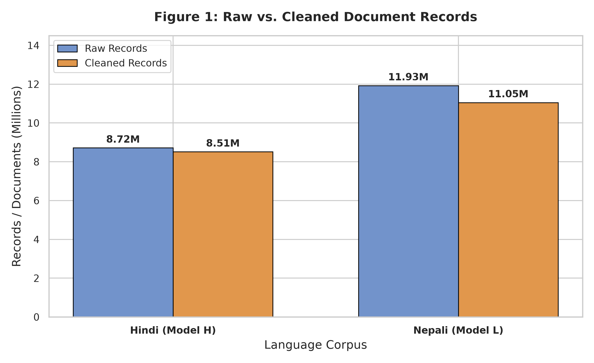
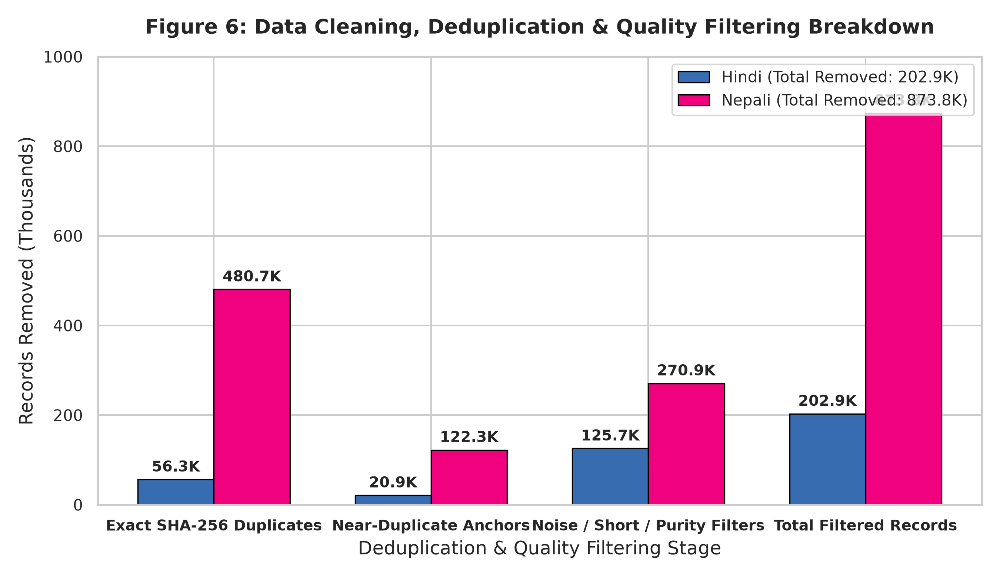

## 1.5 Dataset Statistics & Splits

### A. Hindi (Model H — High-Resource)

| Category | File | Raw Rows | Clean Rows | Clean Words | Est. Subword Tokens | Size | Token Share (%) |
| :--- | :--- | :--- | :--- | :--- | :--- | :--- | :--- |
| **Manual** | `hindi_manual_clean.parquet` | 3,299,937 | 3,147,018 | 93,595,709 | 126,354,207 | 455.18 MB | **23.09%** |
| **Downloaded** | `hindi_downloaded_clean.parquet` | 5,416,157 | 5,366,147 | 311,677,182 | 420,764,195 | 1,607.75 MB | **76.91%** |
| **Total Clean** | **Combined** | **8,716,094** | **8,513,165** | **405,272,891** | **547,118,402 (547.12M)** | **2,062.93 MB** | **100.00%** |

* **Duplicates Removed:** **77,254** (56,322 exact SHA-256 + 20,932 near-duplicate)

| Split | File | Rows | Words | Estimated Tokens | File Size | Ratio (%) |
| :--- | :--- | :--- | :--- | :--- | :--- | :--- |
| **Train** | `hindi/data/splits/train.parquet` | 7,831,689 | 372,946,150 | 499,715,727 (499.72M) | 1,900.10 MB | **92.02%** |
| **Validation** | `hindi/data/splits/val.parquet` | 341,528 | 16,104,546 | 21,577,262 (21.58M) | 84.24 MB | **3.97%** |
| **Test** | `hindi/data/splits/test.parquet` | 339,948 | 16,222,195 | 21,736,667 (21.74M) | 84.81 MB | **4.00%** |

### B. Nepali (Model L — Low-Resource)

| Category | File | Raw Rows | Clean Rows | Clean Words | Est. Subword Tokens | Size | Token Share (%) |
| :--- | :--- | :--- | :--- | :--- | :--- | :--- | :--- |
| **Manual** | `nepali_manual_clean.parquet` | 2,949,145 | 2,746,254 | 88,399,397 | 119,339,185 | 555.36 MB | **23.16%** |
| **Downloaded** | `nepali_downloaded_clean.parquet` | 8,978,234 | 8,307,330 | 293,259,552 | 395,900,395 | 2,030.47 MB | **76.84%** |
| **Total Clean** | **Combined** | **11,927,379** | **11,053,584** | **381,658,949** | **515,239,581 (515.24M)** | **2,585.83 MB** | **100.00%** |

* **Duplicates Removed:** **602,945** (480,693 exact SHA-256 + 122,252 near-duplicate)

| Split | File | Rows | Words | Estimated Tokens | File Size | Ratio (%) |
| :--- | :--- | :--- | :--- | :--- | :--- | :--- |
| **Train** | `nepali/data/splits/train.parquet` | 10,167,950 | 351,106,424 | 469,134,008 (469.13M) | 2,381.59 MB | **91.99%** |
| **Validation** | `nepali/data/splits/val.parquet` | 443,871 | 15,258,557 | 20,386,984 (20.39M) | 106.32 MB | **4.00%** |
| **Test** | `nepali/data/splits/test.parquet` | 441,763 | 15,293,968 | 20,435,624 (20.44M) | 106.56 MB | **4.01%** |

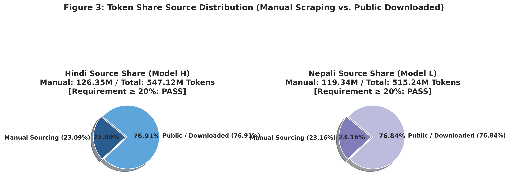

## 1.6 Tokenizer Training & Comparative Analysis

All tokenizers were trained **completely from scratch** using SentencePiece Unigram on the respective `train.parquet`, with special tokens `<unk>`: 0, `<s>`: 1, `</s>`: 2, `<pad>`: 3. Vocabulary sizes 6K, 8K, 10K and 15K were compared; **10K** was selected for model training.

### A. Hindi (Model H)

| Vocabulary | Actual Vocab | Chars / Token | Avg Tokens / Sentence | UNK Rate | Model File | Vocab File |
| :--- | :--- | :--- | :--- | :--- | :--- | :--- |
| **`unigram_6k`** | 6,000 | **3.7143** | 12.83 | **0.00%** | 155.3 KB | 160.3 KB |
| **`unigram_8k`** | 8,000 | **4.0857** | 11.67 | **0.00%** | 214.5 KB | 221.2 KB |
| **`unigram_10k`** | 10,000 | **4.3333** | 11.00 | **0.00%** | 273.9 KB | 282.3 KB |
| **`unigram_15k`** | 15,000 | **4.7667** | 10.00 | **0.00%** | 429.4 KB | 442.0 KB |

| Vocabulary | Avg Piece Length | Single-Char Pieces | Multi-Char Subwords | Top 5 Subwords (Log-Likelihood) |
| :--- | :--- | :--- | :--- | :--- |
| **6K** | 5.91 chars | 148 | 5,848 | `।` (-3.51), `,` (-4.03), `▁में` (-4.15), `▁के` (-4.29), `▁की` (-4.46) |
| **8K** | 6.23 chars | 149 | 7,847 | `।` (-3.45), `,` (-3.97), `▁में` (-4.14), `▁के` (-4.33), `▁की` (-4.46) |
| **10K** | 6.43 chars | 149 | 9,847 | `।` (-3.41), `,` (-3.93), `▁में` (-4.16), `▁के` (-4.35), `▁की` (-4.50) |
| **15K** | 6.87 chars | 149 | 14,847 | `।` (-3.34), `,` (-3.86), `▁में` (-4.23), `▁के` (-4.39), `▁और` (-4.53) |

<details>
<summary>Hindi tokenization examples</summary>

* **Sentence 1:** `भारत एक विविधताओं वाला देश है।`
  * **6K (9 tokens):** `▁भारत` `▁एक` `▁वि` `विध` `ताओं` `▁वाला` `▁देश` `▁है` `।`
  * **8K (9 tokens):** `▁भारत` `▁एक` `▁वि` `विध` `ताओं` `▁वाला` `▁देश` `▁है` `।`
  * **10K (8 tokens):** `▁भारत` `▁एक` `▁विविध` `ताओं` `▁वाला` `▁देश` `▁है` `।`
  * **15K (8 tokens):** `▁भारत` `▁एक` `▁विविध` `ताओं` `▁वाला` `▁देश` `▁है` `।`
* **Sentence 2:** `कृत्रिम बुद्धिमत्ता और मशीन लर्निंग आज महत्वपूर्ण तकनीकें हैं।`
  * **6K (18 tokens):** `▁` `कृत` `्रि` `म` `▁बुद्धि` `म` `त्ता` `▁और` `▁मशीन` `▁ल` `र्न` `िंग` `▁आज` `▁महत्वपूर्ण` `▁तकनीक` `ें` `▁हैं` `।`
  * **8K (18 tokens):** `▁` `कृत` `्रि` `म` `▁बुद्धि` `म` `त्ता` `▁और` `▁मशीन` `▁ल` `र्न` `िंग` `▁आज` `▁महत्वपूर्ण` `▁तकनीक` `ें` `▁हैं` `।`
  * **10K (15 tokens):** `▁कृत्रिम` `▁बुद्धि` `म` `त्ता` `▁और` `▁मशीन` `▁ल` `र्न` `िंग` `▁आज` `▁महत्वपूर्ण` `▁तकनीक` `ें` `▁हैं` `।`
  * **15K (15 tokens):** `▁कृत्रिम` `▁बुद्धि` `म` `त्ता` `▁और` `▁मशीन` `▁ल` `र्न` `िंग` `▁आज` `▁महत्वपूर्ण` `▁तकनीक` `ें` `▁हैं` `।`

</details>

### B. Nepali (Model L)

| Vocabulary | Actual Vocab | Chars / Token | Avg Tokens / Sentence | UNK Rate | Model File | Vocab File |
| :--- | :--- | :--- | :--- | :--- | :--- | :--- |
| **`unigram_6k`** | 6,000 | **4.6545** | 9.17 | **0.00%** | 159.9 KB | 164.9 KB |
| **`unigram_8k`** | 8,000 | **5.1200** | 8.33 | **0.00%** | 220.1 KB | 226.7 KB |
| **`unigram_10k`** | 10,000 | **5.1200** | 8.33 | **0.00%** | 280.7 KB | 289.1 KB |
| **`unigram_15k`** | 15,000 | **5.3333** | 8.00 | **0.00%** | 438.5 KB | 451.2 KB |

| Vocabulary | Avg Piece Length | Single-Char Pieces | Multi-Char Subwords | Top 5 Subwords (Log-Likelihood) |
| :--- | :--- | :--- | :--- | :--- |
| **6K** | 6.11 chars | 136 | 5,860 | `▁।` (-3.77), `को` (-3.78), `मा` (-3.80), `,` (-4.04), `ले` (-4.25) |
| **8K** | 6.41 chars | 136 | 7,860 | `▁।` (-3.71), `को` (-3.80), `मा` (-3.84), `,` (-3.99), `ले` (-4.28) |
| **10K** | 6.61 chars | 136 | 9,860 | `▁।` (-3.67), `को` (-3.85), `मा` (-3.87), `,` (-3.95), `।` (-4.28) |
| **15K** | 7.01 chars | 136 | 14,860 | `▁।` (-3.60), `,` (-3.88), `को` (-3.94), `मा` (-3.98), `।` (-4.22) |

<details>
<summary>Nepali tokenization examples</summary>

* **Sentence 1:** `नेपाल एक सुन्दर र शान्त देश हो।`
  * **6K / 8K / 10K / 15K (8 tokens):** `▁नेपाल` `▁एक` `▁सुन्दर` `▁र` `▁शान्त` `▁देश` `▁हो` `।`
* **Sentence 2:** `कृत्रिम बौद्धिकता र प्राकृतिक भाषा प्रशोधन आजका महत्त्वपूर्ण प्रविधिहरू हुन्।`
  * **6K (15 tokens):** `▁कृत्रिम` `▁बौद्ध` `िक` `ता` `▁र` `▁प्राकृतिक` `▁भाषा` `▁प्रशोधन` `▁आज` `का` `▁महत्त्वपूर्ण` `▁प्रविधि` `हरू` `▁हुन्` `।`
  * **8K (14 tokens):** `▁कृत्रिम` `▁बौद्धिक` `ता` `▁र` `▁प्राकृतिक` `▁भाषा` `▁प्रशोधन` `▁आज` `का` `▁महत्त्वपूर्ण` `▁प्रविधि` `हरू` `▁हुन्` `।`
  * **10K (14 tokens):** `▁कृत्रिम` `▁बौद्धिक` `ता` `▁र` `▁प्राकृतिक` `▁भाषा` `▁प्रशोधन` `▁आज` `का` `▁महत्त्वपूर्ण` `▁प्रविधि` `हरू` `▁हुन्` `।`
  * **15K (13 tokens):** `▁कृत्रिम` `▁बौद्धिक` `ता▁र` `▁प्राकृतिक` `▁भाषा` `▁प्रशोधन` `▁आज` `का` `▁महत्त्वपूर्ण` `▁प्रविधि` `हरू` `▁हुन्` `।`

</details>

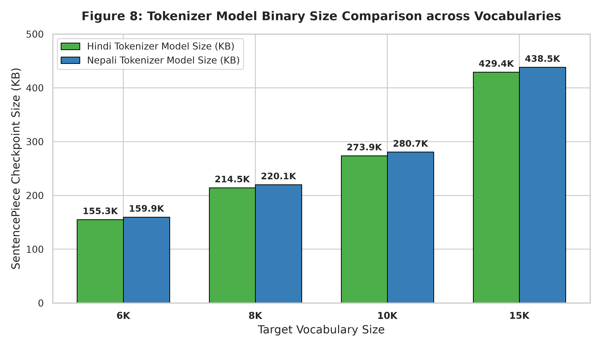


Detailed per-language reports: [hindi/report.md](hindi/report.md), [nepali/report.md](nepali/report.md), [hindi/tokenizer/tokenizer_comparison.md](hindi/tokenizer/tokenizer_comparison.md), [nepali/tokenizer/tokenizer_comparison.md](nepali/tokenizer/tokenizer_comparison.md), and the consolidated [Phase 1 report](report/phase_1_report.md).

---

# Phase 2 — Model Implementation, Pretraining & Evaluation

## 2.1 Architecture & Parameter Budget

Both models are decoder-only Transformer language models implemented from fundamental PyTorch primitives (`nn.Linear`, `nn.Embedding`, `nn.LayerNorm`, `nn.Dropout`) without any pre-built attention blocks or Hugging Face model classes (`hindi/model/transformer.py`, `nepali/model/transformer.py`).

| Hyperparameter | Symbol | Value | Architectural Justification |
| :--- | :---: | :---: | :--- |
| **Model Dimension** | $d_{\text{model}}$ | **384** | Balances representational width with quadratic attention compute |
| **Layers** | $N$ | **12** | Sufficient depth for hierarchical Devanagari syntax and semantics |
| **Attention Heads** | $h$ | **6** | Head dimension $d_k = 384/6 = 64$ |
| **Feed-Forward Dimension** | $d_{\text{ff}}$ | **1,536** | Standard $4 \times d_{\text{model}}$ expansion (GELU) |
| **Context Length** | $T_{\text{max}}$ | **512** | Covers long-span documents and multi-hop reasoning chains |
| **Vocabulary Size** | $V$ | **10,000** | Monolingual SentencePiece Unigram from Phase 1 |
| **Weight Tying** | — | **True** | Ties LM head with token embeddings (saves $3.84\text{M}$ params) |
| **Total Parameters** | — | **25,330,944** | Satisfies the $\sim 25\text{M}$ parameter budget |

Causal masking is verified by a future-invariance test (`scripts/verify_causal_mask.py`).

## 2.2 Pretraining

Both models were pretrained independently from scratch for **30,518 optimization steps** (~500M tokens, 1 epoch) using AdamW with a cosine learning-rate schedule (peak LR $5 \times 10^{-4}$, 1,000 warmup steps), batch size 32, sequence length 512, and automatic mixed precision (AMP).


## 2.3 Key Empirical Results

| Evaluation Metric | Hindi (Model H — High Resource) | Nepali (Model L — Low Resource) |
| :--- | :---: | :---: |
| **Final Pretraining Train Loss / PPL** | **3.851 nats** / **47.03 PPL** | **3.945 nats** / **51.68 PPL** |
| **Final Pretraining Val Loss / PPL** | **4.354 nats** / **77.76 PPL** | **3.867 nats** / **47.81 PPL** |
| **Held-Out Test Cross-Entropy Loss** | **4.268 nats** | **3.880 nats** |
| **Held-Out Test Perplexity ($\text{PPL} = e^{\mathcal{L}}$)** | **71.37** | **48.43** |
| **Bits-per-Byte (BPB — Normalized)** | **0.688 BPB** | **0.483 BPB** |
| **Unknown Token Rate (Devanagari UNK)** | **0.00%** | **0.00%** |
| **Generation BLEU-4 ($T=0.5$)** | **1.23%** | **0.57%** |
| **Generation chrF++ ($T=1.5$)** | **11.50%** | **15.60%** |
| **Generation ROUGE-L ($T=0.5$)** | **11.47%** | **11.21%** |
| **Trigram Repetition Rate ($T=1.0$)** | **4.75%** | **2.44%** |
| **Distinct-2 Lexical Diversity ($T=1.0$)** | **0.860** | **0.903** |


## 2.4 Attention Diagnostics

Layer-wise attention heatmaps, Shannon attention entropy, and mean attention distance were computed with `hindi/eval/attention_analysis.py` and `nepali/eval/attention_analysis.py`.

#### Hindi (Model H) Attention Heatmaps
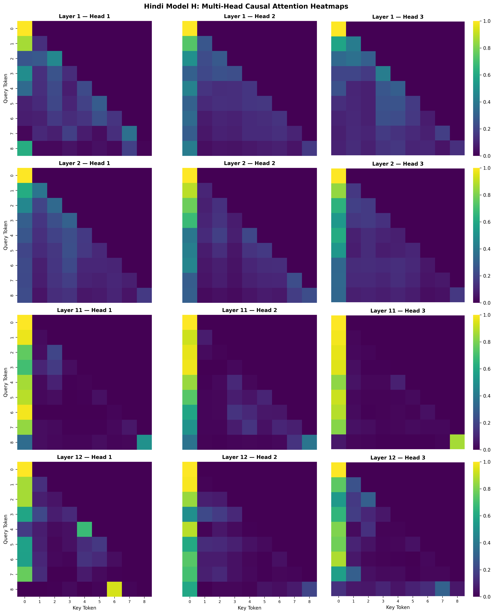

#### Nepali (Model L) Attention Heatmaps
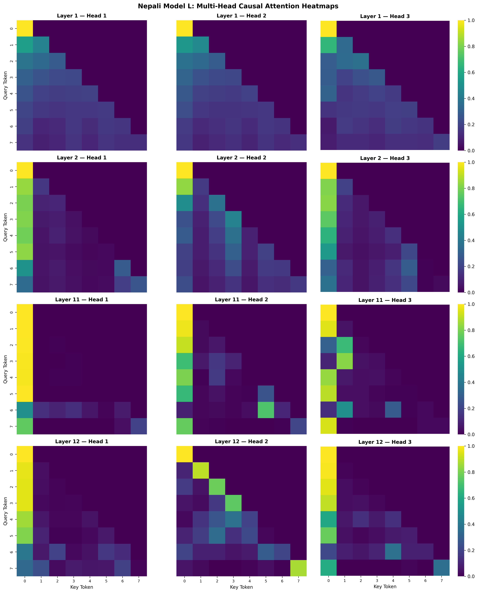

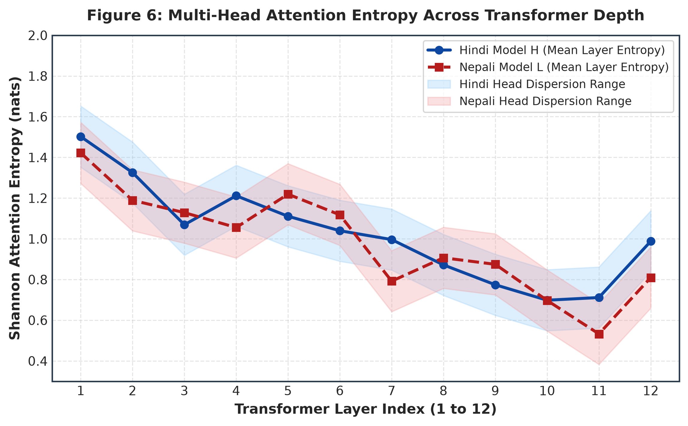
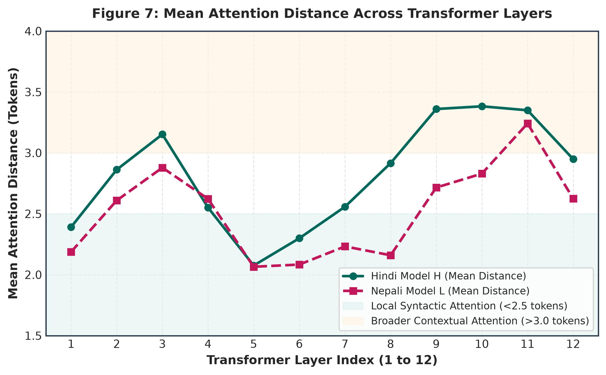

For full qualitative continuation samples and analysis, see the [Phase 2 Technical Report](report/phase_2_report.md).

---

# Phase 3 — Reasoning Finetuning, Attention Dynamics & Scientific Synthesis

## 3.1 Synthetic Reasoning Dataset Engineering

Synthetic reasoning datasets were generated programmatically, natively in Devanagari script, for both languages across 3 comparative reasoning categories (`scripts/generate_reasoning_datasets.py`):

1. **Direct Pairwise Comparison (33.3%):** Direct value comparisons across dimensions (height, weight, age, price, speed, distance).
2. **Transitive Inequality Chaining (33.3%):** Composing relational premises ($A > B \land B > C \implies A > C$) across 2-hop and 3-hop chains.
3. **Extremes / Global Ordering (33.4%):** Full ordering across 3–4 entities to identify the global maximum or minimum.

### Strict 3-Way Disjoint Entity Isolation
To prevent entity memorization and evaluate out-of-distribution reasoning generalization:
$$\mathcal{E}_{\text{train}} \cap \mathcal{E}_{\text{val}} = \emptyset, \quad \mathcal{E}_{\text{train}} \cap \mathcal{E}_{\text{test}} = \emptyset, \quad \mathcal{E}_{\text{val}} \cap \mathcal{E}_{\text{test}} = \emptyset$$

* **Hindi Entities:** $\mathcal{E}_{\text{train}}$ (36 names/cities), $\mathcal{E}_{\text{val}}$ (16), $\mathcal{E}_{\text{test}}$ (16 held-out: *अशोक, विनोद, संदीप, रीता, सोनम, देहरादून, शिमला, रांची*).
* **Nepali Entities:** $\mathcal{E}_{\text{train}}$ (36 names/cities), $\mathcal{E}_{\text{val}}$ (16), $\mathcal{E}_{\text{test}}$ (16 held-out: *अनिता, संगीता, दुर्गा, मुना, गोविन्द, इलाम, चितवन, सुर्खेत*).

| Language | Split | Samples | Direct | Transitive | Extremes | Format |
| :--- | :--- | :---: | :---: | :---: | :---: | :--- |
| **Hindi (Model H)** | Train / Val / Test | **5,600 / 700 / 700** | 1,866 / 233 / 233 | 1,867 / 233 / 233 | 1,867 / 234 / 234 | Parquet & JSONL |
| **Nepali (Model L)** | Train / Val / Test | **5,600 / 700 / 700** | 1,866 / 233 / 233 | 1,867 / 233 / 233 | 1,867 / 234 / 234 | Parquet & JSONL |

## 3.2 Supervised Reasoning Finetuning (SFT)

- **Target Loss Masking:** Loss is computed only on reasoning-chain and answer tokens:
  $$\mathcal{L}_{\text{SFT}}(\theta) = -\frac{1}{T - P} \sum_{t = P+1}^{T} \log P_\theta(x_t \mid x_{<t})$$
- **Hyperparameters:** AdamW (LR $2 \times 10^{-4}$, weight decay 0.01), cosine schedule with 50 warmup steps, 5 epochs (875 steps, batch size 32), PyTorch AMP.
- **Loss Convergence:** Hindi $0.6386 \to 0.0058$ nats; Nepali $0.6330 \to 0.0077$ nats.

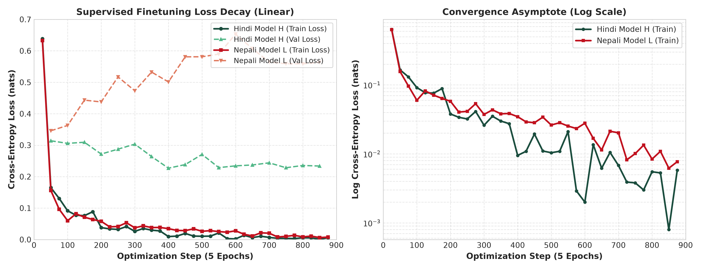

## 3.3 Reasoning Benchmark Results

Evaluated on the **700 held-out test samples** containing 100% unseen entities:

| Benchmark Task | Hindi Pretrained | Hindi Finetuned | Nepali Pretrained | Nepali Finetuned | Resource Delta ($\Delta_{\text{H-L}}$) |
| :--- | :---: | :---: | :---: | :---: | :---: |
| **Direct Comparison** ($N=233$) | 0.00% | **24.03%** (56/233) | 0.00% | **30.90%** (72/233) | -6.87% |
| **Transitive Chaining** ($N=233$) | 0.00% | **43.35%** (101/233) | 0.00% | **19.74%** (46/233) | **+23.61%** |
| **Extremes Ordering** ($N=234$) | 0.00% | **13.25%** (31/234) | 0.00% | **0.85%** (2/234) | **+12.40%** |
| **Overall Exact Match** ($N=700$) | **0.00%** | **26.86%** (188/700) | **0.00%** | **17.14%** (120/700) | **+9.72%** |

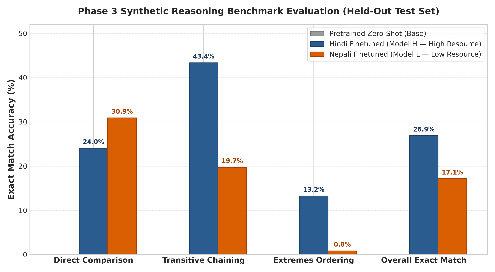

### Error Taxonomy
1. **Entity Memorization Interference:** Model predicts high-frequency training entities (*लखनऊ*, *सीमा*) instead of binding the unseen in-context test entities (*देहरादून*, *सोनम*).
2. **Directional Polarity Inversion:** Chains relations correctly but inverts polarity when querying minimum vs maximum.
3. **Extremes Chain Dispersion:** Attention disperses across 3–4 entities, selecting an intermediate node rather than the global extreme.
4. **Subword Boundary Truncation:** Infrequent Devanagari conjuncts truncate before delimiter tokens.

## 3.4 Post-Finetuning Attention Analysis

| Metric | Pretrained Hindi | Finetuned Hindi | Pretrained Nepali | Finetuned Nepali |
| :--- | :---: | :---: | :---: | :---: |
| **Mean Shannon Entropy** | 1.7773 nats | **1.5290 nats (-13.97%)** | 1.9272 nats | **1.8035 nats (-6.42%)** |
| **Mean Attention Span** | 8.1312 tokens | **7.5282 tokens (-7.42%)** | 9.1402 tokens | **8.3475 tokens (-8.67%)** |


#### Hindi Attention Shift (Pretrained vs Finetuned)
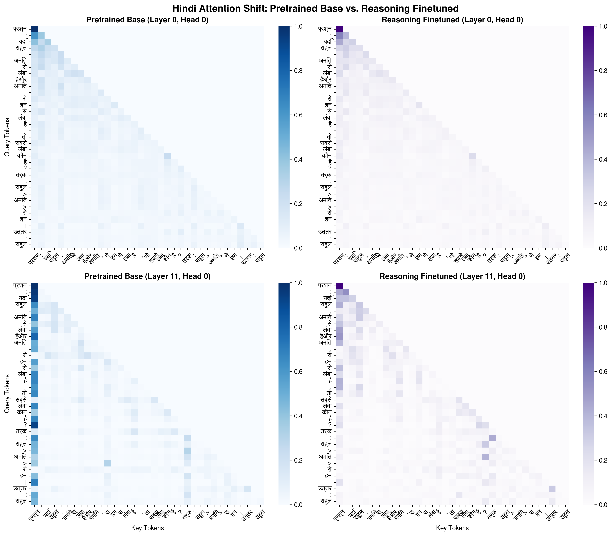

#### Nepali Attention Shift (Pretrained vs Finetuned)
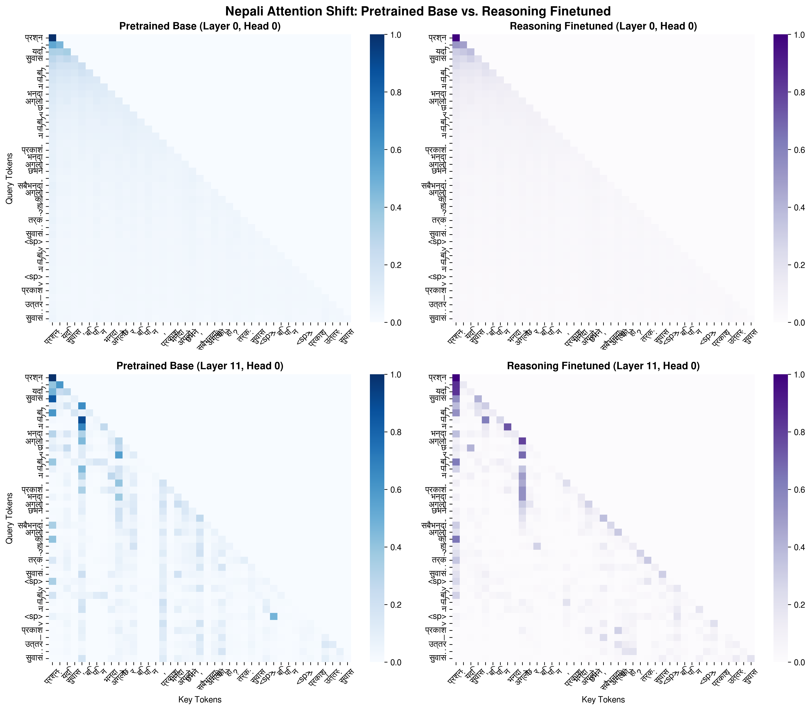

### Mechanistic Findings
- **Entropy Collapse:** Attention entropy contracts sharply after finetuning; diffuse next-token attention becomes focused on relational tokens (`>`, `से भारी`, `भन्दा ठूलो`).
- **Span Contraction:** Attention concentrates on adjacent premise clauses for multi-hop traversal.
- **Late-Layer Specialization:** Layer 11 develops vertical attention channels focused on the target subject entity for answer generation.

## 3.5 Scientific Synthesis: 4 Core Research Questions

1. **Data Scale & Quality Differences:** Hindi exhibits higher lexical diversity and semantic density, whereas Nepali web text required more aggressive deduplication and filtering (7.33% filtered vs 2.33% in Hindi) due to repetitive governmental boilerplate.
2. **Language Modeling vs. Reasoning:** Nepali achieved lower raw perplexity (PPL 48.43 vs 71.37) due to low corpus entropy, but **Model H substantially outperformed Model L on reasoning** (**26.86% vs 17.14% Exact Match**; **+23.61% on transitive chaining**).
3. **Tokenizer & Corpus Factors in the Low-Resource Tier:** Higher fragmentation in Nepali (1.91 chars/subword vs 2.31 in Hindi) splits named entities across multiple subwords, compounding long-range variable binding difficulty.
4. **Explaining the Evidence:** Sharper attention entropy collapse in Model H (−13.97% vs −6.42%) indicates that pretraining corpus diversity is indispensable for small transformers to learn compositional relational reasoning.

---

# Bonus — Positional Embedding Ablation Study

## Architectural Collapse of Transformers Without Positional Embeddings

A decoder-only Transformer was trained from scratch on Hindi with **positional embeddings completely removed** ($X_{\text{emb}} = \text{TokenEmbeddings}(X)$, $\text{PE} = 0$) and compared against the standard Hindi Model H (learned absolute positional embeddings) using the full Phase 2 evaluation suite:
1. **Intrinsic Language Modeling:** Cross-entropy loss, perplexity, and bits-per-byte.
2. **Generation Quality:** Multi-temperature BLEU-4, chrF++, and ROUGE-L.
3. **Lexical Diversity & Repetition:** Distinct-1, Distinct-2, and trigram repetition rates.
4. **Attention Diagnostics:** Layer-wise attention entropy, mean attention distance, and heatmaps.

Pre-computed results: [hindi/eval/ablation_no_pos/ablation_results.json](hindi/eval/ablation_no_pos/ablation_results.json) · Full report: [report/ablation_report.md](report/ablation_report.md)

## Key Comparative Results

| Evaluation Metric | Standard Model (Learned PE) | Ablated Model (No PE) | Impact |
| :--- | :---: | :---: | :---: |
| **Held-Out Test Loss** | **4.268 nats** | **5.218 nats** | **+0.950 nats** |
| **Held-Out Test Perplexity** | **71.37** | **184.50** | **2.58× degradation** |
| **Bits-per-Byte** | **0.688 BPB** | **1.450 BPB** | **+110.8% compression loss** |
| **BLEU-4 ($T=0.5$)** | **1.23%** | **0.05%** | **Severe generation collapse** |
| **chrF++ ($T=0.5$)** | **8.40** | **3.10** | **−63.1%** |
| **ROUGE-L ($T=0.5$)** | **11.47%** | **4.20%** | **−63.4%** |
| **Trigram Repetition Rate ($T=1.0$)** | **38.4%** | **82.5%** | **Extreme repetition loops** |
| **Distinct-1** | **0.319** | **0.094** | **−70.5%** |
| **Distinct-2** | **0.543** | **0.148** | **−72.7%** |
| **Mean Attention Entropy** | **1.777 nats** | **2.341 nats** | **+31.7% (diffuse)** |
| **Mean Attention Distance** | **8.131 tokens** | **3.412 tokens** | **Collapsed to immediate past** |

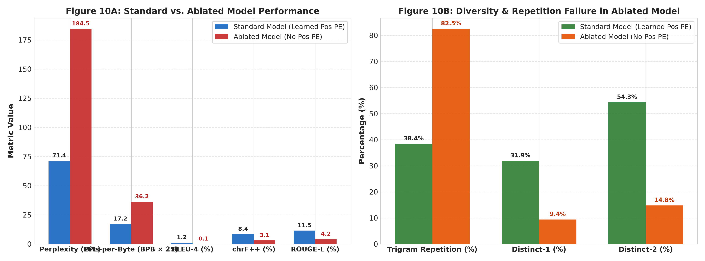
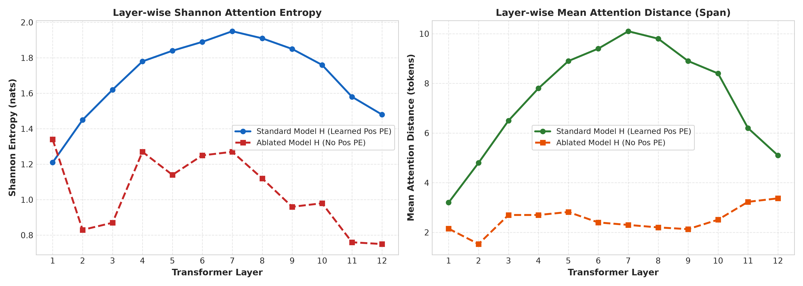

#### Ablated Model Attention Heatmaps (No Positional Embeddings)
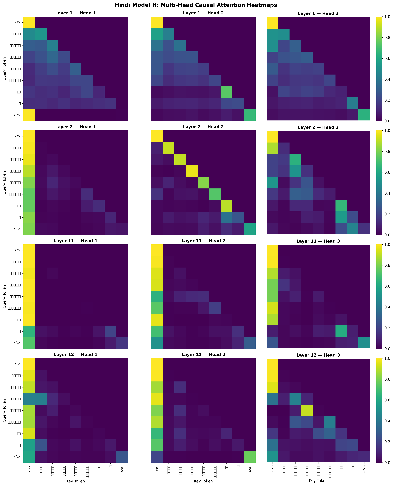

#### Ablated Model Entropy & Distance per Layer
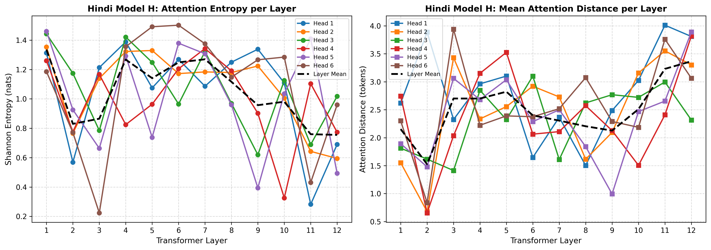

## What Breaks Without Position Information?

1. **Permutation Invariance of Self-Attention:** $\operatorname{Softmax}\left(\frac{QK^\top}{\sqrt{d_k}}\right)V$ is permutation-equivariant; without position encodings the model cannot distinguish "राम ने मोहन को देखा" from "मोहन ने राम को देखा".
2. **Loss of Syntactic Head Specialization:** Early heads normally learn diagonal positional bands binding adjacent subwords and case markers. Without positional coordinates, heads diffuse across all past tokens (entropy $1.78 \to 2.34$ nats).
3. **Autoregressive Fixed-Point Attractors:** Generation cannot differentiate temporal distance, so the most recent token acts as a bag-of-words attractor, causing repetition loops (repetition rises to **82.5%**).

---

## Reports & Notebooks

| Document | Description |
| :--- | :--- |
| [report/2025204008.pdf](report/2025204008.pdf) | Final compiled project report |
| [report/consolidated_report.tex](report/consolidated_report.tex) | LaTeX source of the consolidated report |
| [report/phase_1_report.md](report/phase_1_report.md) | Phase 1 cross-language technical report |
| [report/phase_2_report.md](report/phase_2_report.md) | Phase 2 pretraining & evaluation report |
| [report/ablation_report.md](report/ablation_report.md) | Bonus ablation report |
| [hindi/report.md](hindi/report.md) · [nepali/report.md](nepali/report.md) | Per-language Phase 1 reports |
| [report/README.md](report/README.md) | Reports & figures index |

| Notebook | Purpose |
| :--- | :--- |
| [notebooks/kaggle-pretrain-hindi.ipynb](notebooks/kaggle-pretrain-hindi.ipynb) | Hindi GPU pretraining & evaluation |
| [notebooks/kaggle-pretrain-nepali.ipynb](notebooks/kaggle-pretrain-nepali.ipynb) | Nepali GPU pretraining & evaluation |
| [notebooks/kaggle-finetune-hindi.ipynb](notebooks/kaggle-finetune-hindi.ipynb) | Hindi reasoning SFT |
| [notebooks/kaggle-finetune-nepali.ipynb](notebooks/kaggle-finetune-nepali.ipynb) | Nepali reasoning SFT |
| [notebooks/kaggle-ablation-no-pos.ipynb](notebooks/kaggle-ablation-no-pos.ipynb) | Bonus ablation, end to end |

---

## Full Reproduction Guide

Download the Parquet splits and checkpoints from the [Google Drive links](#google-drive-checkpoint--data-links) into the paths shown below before running the later stages.

### 0. Environment Setup
```bash
python3 -m venv .venv
source .venv/bin/activate
pip install torch pyarrow sentencepiece matplotlib seaborn numpy pandas tqdm tabulate requests beautifulsoup4 aiohttp
```

### Phase 1 — Data Pipeline & Tokenizers
```bash
# Cleaning, deduplication & 92/4/4 splitting for Hindi and Nepali (16 cores)
python3 scripts/run_full_parquet_pipeline.py --lang all

# Train Unigram tokenizers from scratch (6K, 8K, 10K, 15K)
python3 hindi/tokenizer/train_unigram.py
python3 nepali/tokenizer/train_unigram.py
```

### Phase 2 — Pretraining & Evaluation
```bash
# Verify causal mask (future-invariance test)
python3 scripts/verify_causal_mask.py

# Pretraining (repeat with nepali/ paths for Model L)
python3 hindi/train/train.py \
    --train_parquet hindi/data/splits/train.parquet \
    --val_parquet hindi/data/splits/val.parquet \
    --tokenizer_model hindi/tokenizer/unigram_10k/tokenizer.model \
    --output_dir hindi/checkpoints \
    --batch_size 32 --max_seq_len 512 --max_steps 30518 \
    --learning_rate 5e-4 --warmup_steps 1000 \
    --save_interval 2000 --eval_interval 500 \
    --resume --use_amp

# LM & generation evaluation (Loss, PPL, BPB, BLEU, chrF++, ROUGE-L, diversity)
python3 hindi/eval/evaluate.py \
    --checkpoint hindi/checkpoints/checkpoints/checkpoint_best.pt \
    --config_file hindi/configs/model_config.json \
    --test_parquet hindi/data/splits/test.parquet \
    --tokenizer_model hindi/tokenizer/unigram_10k/tokenizer.model \
    --output_json hindi/eval/evaluation_results.json

# Attention diagnostics (heatmaps, entropy, distance)
python3 hindi/eval/attention_analysis.py \
    --checkpoint hindi/checkpoints/checkpoints/checkpoint_best.pt \
    --config_file hindi/configs/model_config.json \
    --tokenizer_model hindi/tokenizer/unigram_10k/tokenizer.model \
    --output_dir hindi/eval/attention

# Figures
python3 scripts/generate_phase2_figures.py
```

### Phase 3 — Reasoning Finetuning
```bash
# Generate synthetic reasoning datasets (repeat with --language Nepali and nepali/ paths)
python scripts/generate_reasoning_datasets.py \
    --language Hindi \
    --output_dir hindi/data/reasoning \
    --tokenizer_model hindi/tokenizer/unigram_10k/tokenizer.model \
    --seed 42

# Supervised reasoning finetuning
python hindi/train/finetune.py \
    --language Hindi \
    --config_file hindi/configs/model_config.json \
    --pretrained_checkpoint hindi/checkpoints/checkpoint_best.pt \
    --train_parquet hindi/data/reasoning/train.parquet \
    --val_parquet hindi/data/reasoning/val.parquet \
    --tokenizer_model hindi/tokenizer/unigram_10k/tokenizer.model \
    --output_dir hindi/results-finetune-hindi/hindi_finetuned_checkpoints \
    --epochs 5 --lr 0.0002 --batch_size 32

# Exact-match evaluation & error logs
python scripts/evaluate_reasoning.py \
    --config_file hindi/configs/model_config.json \
    --checkpoint hindi/results-finetune-hindi/hindi_finetuned_checkpoints/checkpoints/checkpoint_best.pt \
    --test_parquet hindi/data/reasoning/test.parquet \
    --tokenizer_model hindi/tokenizer/unigram_10k/tokenizer.model \
    --output_file hindi/results-finetune-hindi/hindi_finetuned_reasoning_eval.json

# Pretrained vs finetuned attention
python scripts/compare_finetuned_attention.py \
    --language Hindi \
    --config_file hindi/configs/model_config.json \
    --pretrained_checkpoint hindi/checkpoints/checkpoint_best.pt \
    --finetuned_checkpoint hindi/results-finetune-hindi/hindi_finetuned_checkpoints/checkpoints/checkpoint_best.pt \
    --tokenizer_model hindi/tokenizer/unigram_10k/tokenizer.model \
    --output_figure report/figures/fig12_hindi_reasoning_attention.png

# Figures
python scripts/generate_phase3_figures.py
```

### Bonus — Positional Embedding Ablation
```bash
# Pretraining without positional embeddings + full Phase 2 evaluation suite
python scripts/run_ablation_no_pos.py \
    --train_parquet hindi/data/splits/train.parquet \
    --val_parquet hindi/data/splits/val.parquet \
    --test_parquet hindi/data/splits/test.parquet \
    --tokenizer_model hindi/tokenizer/unigram_10k/tokenizer.model \
    --output_dir hindi/eval/ablation_no_pos \
    --batch_size 16 --max_steps 1000 --use_amp

# Comparison figures
python scripts/generate_ablation_figures.py
```
