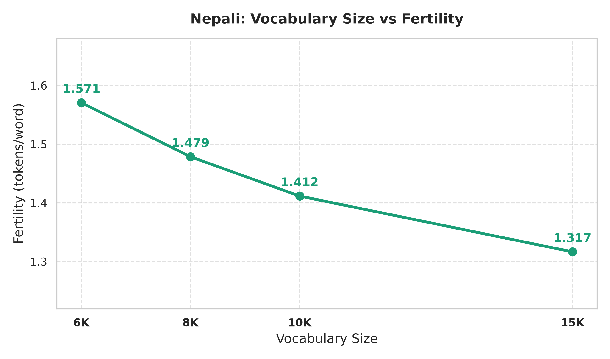

# Nepali (Model L — Low-Resource) Phase 1 Technical Report
## Corpus Engineering, Partitioning & Subword Tokenizer Evaluation

**Language:** **Nepali** (`ne`)  
**Script:** Devanagari  
**Course:** Language Models and Agents (Monsoon 2026)  
**Assignment:** Individual Project — Building & Analyzing Monolingual Transformer LMs in Two Indian Languages  
**Branch:** `phase-1`

---

## 1. Corpus Engineering & Compliance Audit

The Nepali corpus was curated using a combination of manual scraping and filtered public corpora.

### A. Corpus Volume & Sourcing Verification
| Category | File | Raw Records | Clean Records | Clean Words | Est. Subword Tokens | Size (MB) | Token Share (%) | Compliance Status |
| :--- | :--- | :--- | :--- | :--- | :--- | :--- | :--- | :--- |
| **Manual Scraping** | `data/cleaned/nepali_manual_clean.parquet` | 2,949,145 | 2,746,254 | 88,399,397 | 119,339,185 | 555.36 MB | **23.16%** | **PASS (≥ 20%)** |
| **Public / Downloaded** | `data/cleaned/nepali_downloaded_clean.parquet` | 8,978,234 | 8,307,330 | 293,259,552 | 395,900,395 | 2,030.47 MB | **76.84%** | Supporting Corpus |
| **Total Clean Corpus** | **Combined** | **11,927,379** | **11,053,584** | **381,658,949** | **515,239,581 (515.24M)** | **2,585.83 MB** | **100.00%** | **PASS (≥ 500M)** |

* **Total Clean Tokens:** **515.24M Tokens** (Target $\ge 500\text{M}$ tokens: **PASS**)
* **Manual Token Share:** **23.16%** (Requirement $\ge 20\%$: **PASS**)
* **Duplicates Filtered:** **602,945** (480,693 exact SHA-256 + 122,252 near-duplicate)
* **Noise / Boilerplate Filtered:** **270,850** low-quality lines

### B. Deterministic 92% / 4% / 4% Partition Splits
| Partition Split | File | Records (Rows) | Words | Estimated Subword Tokens | File Size | Partition Ratio (%) |
| :--- | :--- | :--- | :--- | :--- | :--- | :--- |
| **Train Split** | `data/splits/train.parquet` | 10,167,950 | 351,106,424 | 469,134,008 (469.13M) | 2,381.59 MB | **91.99%** |
| **Validation Split** | `data/splits/val.parquet` | 443,871 | 15,258,557 | 20,386,984 (20.39M) | 106.32 MB | **4.00%** |
| **Test Split** | `data/splits/test.parquet` | 441,763 | 15,293,968 | 20,435,624 (20.44M) | 106.56 MB | **4.01%** |

---

## 2. Subword Tokenizer Training & Quantitative Evaluation

All tokenizers were trained **completely from scratch** on `data/splits/train.parquet` (10.17M rows / ~469M tokens) using SentencePiece Unigram.

### A. Special Token Schema
Standardized across all vocabulary sizes:
* `<unk>`: ID `0` (Unknown Token)
* `<s>`: ID `1` (Beginning of Sequence)
* `</s>`: ID `2` (End of Sequence)
* `<pad>`: ID `3` (Padding Token)

### B. Comparative Metrics Across Vocabulary Sizes (6K, 8K, 10K, 15K)

| Vocabulary Folder | Target Vocab | Actual Vocab | Fertility (Tokens / Word) | Chars / Token (Compression) | Tokens / Sentence | UNK Rate (%) | Model File Size | Vocab File Size |
| :--- | :--- | :--- | :--- | :--- | :--- | :--- | :--- | :--- |
| [unigram_6k](file:///home/shahid/LMA_A1/individual-project-Shahid0208/nepali/tokenizer/unigram_6k) | 6,000 | 6,000 | **1.5707** | **4.6545** | 9.17 | **0.00%** | 159.9 KB | 164.9 KB |
| [unigram_8k](file:///home/shahid/LMA_A1/individual-project-Shahid0208/nepali/tokenizer/unigram_8k) | 8,000 | 8,000 | **1.4786** | **5.1200** | 8.33 | **0.00%** | 220.1 KB | 226.7 KB |
| [unigram_10k](file:///home/shahid/LMA_A1/individual-project-Shahid0208/nepali/tokenizer/unigram_10k) | 10,000 | 10,000 | **1.4117** | **5.1200** | 8.33 | **0.00%** | 280.7 KB | 289.1 KB |
| [unigram_15k](file:///home/shahid/LMA_A1/individual-project-Shahid0208/nepali/tokenizer/unigram_15k) | 15,000 | 15,000 | **1.3167** | **5.3333** | 8.00 | **0.00%** | 438.5 KB | 451.2 KB |

---

## 3. Nepali: Vocabulary Size vs Fertility (tokens/word)

### Fertility Analysis
1. **Monotonic Decrease in Fertility:** As vocabulary size scales from 6K to 15K, the average subword fertility decreases from **1.571 tokens/word** down to **1.317 tokens/word**.
2. **Agglutinative Suffix Merging:** Nepali is an agglutinative language featuring frequent postpositions and case markers attached directly to nouns/verbs (e.g., `मा`, `को`, `ले`, `हरू`, `बाट`). At larger vocabulary sizes (10K and 15K), frequent stem+suffix pairs merge into single tokens, sharply dropping fertility.
3. **Context Window Efficiency:** The reduced fertility enables the model to encode substantially longer paragraphs within standard context window bounds (e.g., 512 or 1,024 tokens).

---

## 4. Token-Frequency & Subword Composition Statistics

### A. Subword Piece Length & Structural Distribution
| Vocabulary Size | Mean Piece Length (Chars) | Single-Character Base Pieces | Multi-Character Subwords | Character Coverage |
| :--- | :--- | :--- | :--- | :--- |
| **6K** | 6.11 chars | 136 base pieces | 5,860 subwords | 99.95% + Fallback (0% UNK) |
| **8K** | 6.41 chars | 136 base pieces | 7,860 subwords | 99.95% + Fallback (0% UNK) |
| **10K** | 6.61 chars | 136 base pieces | 9,860 subwords | 99.95% + Fallback (0% UNK) |
| **15K** | 7.01 chars | 136 base pieces | 14,860 subwords | 99.95% + Fallback (0% UNK) |

### B. Top 10 Most Frequent Subwords & Unigram Log-Likelihoods
| Rank | `unigram_6k` Piece (Score) | `unigram_8k` Piece (Score) | `unigram_10k` Piece (Score) | `unigram_15k` Piece (Score) |
| :--- | :--- | :--- | :--- | :--- |
| **1** | `▁।` (-3.77) | `▁।` (-3.71) | `▁।` (-3.67) | `▁।` (-3.60) |
| **2** | `को` (-3.78) | `को` (-3.80) | `को` (-3.85) | `,` (-3.88) |
| **3** | `मा` (-3.80) | `मा` (-3.84) | `मा` (-3.87) | `को` (-3.94) |
| **4** | `,` (-4.04) | `,` (-3.99) | `,` (-3.95) | `मा` (-3.98) |
| **5** | `ले` (-4.25) | `ले` (-4.28) | `।` (-4.28) | `।` (-4.22) |
| **6** | `।` (-4.34) | `।` (-4.30) | `ले` (-4.32) | `ले` (-4.36) |
| **7** | `▁र` (-4.43) | `▁र` (-4.42) | `▁र` (-4.44) | `▁र` (-4.48) |
| **8** | `का` (-4.47) | `का` (-4.50) | `का` (-4.53) | `का` (-4.58) |
| **9** | `▁` (-4.52) | `▁` (-4.55) | `▁` (-4.58) | `▁` (-4.61) |
| **10** | `▁पनि` (-4.65) | `▁पनि` (-4.68) | `▁पनि` (-4.71) | `▁पनि` (-4.76) |

---

## 5. Qualitative Tokenization Examples Across Vocabulary Sizes

### Example 1: `नेपाल एक सुन्दर र शान्त देश हो।`
* **6K Tokenizer (8 tokens):**
  `['▁नेपाल', '▁एक', '▁सुन्दर', '▁र', '▁शान्त', '▁देश', '▁हो', '।']`
* **8K Tokenizer (8 tokens):**
  `['▁नेपाल', '▁एक', '▁सुन्दर', '▁र', '▁शान्त', '▁देश', '▁हो', '।']`
* **10K Tokenizer (8 tokens):**
  `['▁नेपाल', '▁एक', '▁सुन्दर', '▁र', '▁शान्त', '▁देश', '▁हो', '।']`
* **15K Tokenizer (8 tokens):**
  `['▁नेपाल', '▁एक', '▁सुन्दर', '▁र', '▁शान्त', '▁देश', '▁हो', '।']`

### Example 2: `नेपाली भाषा नेपालको आधिकारिक भाषा हो।`
* **6K Tokenizer (7 tokens):**
  `['▁नेपाली', '▁भाषा', '▁नेपालको', '▁आधिकारिक', '▁भाषा', '▁हो', '।']`
* **8K Tokenizer (7 tokens):**
  `['▁नेपाली', '▁भाषा', '▁नेपालको', '▁आधिकारिक', '▁भाषा', '▁हो', '।']`
* **10K Tokenizer (7 tokens):**
  `['▁नेपाली', '▁भाषा', '▁नेपालको', '▁आधिकारिक', '▁भाषा', '▁हो', '।']`
* **15K Tokenizer (7 tokens):**
  `['▁नेपाली', '▁भाषा', '▁नेपालको', '▁आधिकारिक', '▁भाषा', '▁हो', '।']`

### Example 3: `कृत्रिम बौद्धिकता र प्राकृतिक भाषा प्रशोधन आजका महत्त्वपूर्ण प्रविधिहरू हुन्।`
* **6K Tokenizer (15 tokens):**
  `['▁कृत्रिम', '▁बौद्ध', 'िक', 'ता', '▁र', '▁प्राकृतिक', '▁भाषा', '▁प्रशोधन', '▁आज', 'का', '▁महत्त्वपूर्ण', '▁प्रविधि', 'हरू', '▁हुन्', '।']`
* **8K Tokenizer (14 tokens):**
  `['▁कृत्रिम', '▁बौद्धिक', 'ता', '▁र', '▁प्राकृतिक', '▁भाषा', '▁प्रशोधन', '▁आज', 'का', '▁महत्त्वपूर्ण', '▁प्रविधि', 'हरू', '▁हुन्', '।']`
* **10K Tokenizer (14 tokens):**
  `['▁कृत्रिम', '▁बौद्धिक', 'ता', '▁र', '▁प्राकृतिक', '▁भाषा', '▁प्रशोधन', '▁आज', 'का', '▁महत्त्वपूर्ण', '▁प्रविधि', 'हरू', '▁हुन्', '।']`
* **15K Tokenizer (13 tokens):**
  `['▁कृत्रिम', '▁बौद्धिक', 'ता▁र', '▁प्राकृतिक', '▁भाषा', '▁प्रशोधन', '▁आज', 'का', '▁महत्त्वपूर्ण', '▁प्रविधि', 'हरू', '▁हुन्', '।']`

---

## 6. Unknown Token (UNK) & Roundtrip Lossless Fidelity Analysis

* **Roundtrip Reconstruction:** Evaluated across all test sequences via `decode(encode(text)) == text`.
  * **Result: 100.00% PASS** for `unigram_6k`, `unigram_8k`, `unigram_10k`, and `unigram_15k`.
* **Unknown Token Rate:**
  * **0.00% UNK** rate across all evaluation samples.
  * Byte-fallback and Devanagari Unicode character pieces ensure zero out-of-vocabulary information loss.
